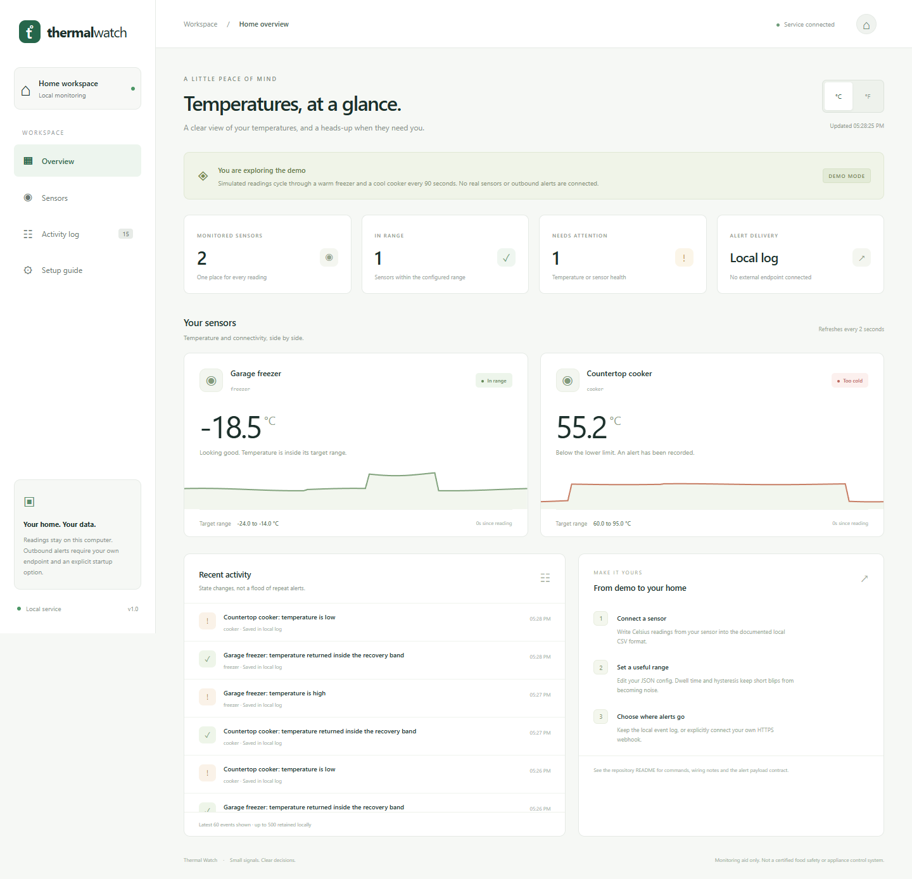

# Thermal Watch

A local home dashboard for freezer and cooker temperatures. It notices sustained excursions, distinguishes a disconnected sensor from a healthy reading, and keeps an event history you can inspect.



## Run the demo

Requires Python 3.11 or later. The application has no third-party Python dependencies.

```sh
python -m thermal_watch
```

Open **http://127.0.0.1:8766**. The demo simulates two sensors, a warm freezer, a cool cooker, and their recoveries over a 90-second cycle. It uses an in-memory database and cannot send outbound notifications. No account, API key, microphone, camera, or appliance is involved.

## Try your own readings

```sh
python -m thermal_watch sample --output readings.csv
python -m thermal_watch serve --csv readings.csv --config config.example.json
```

In another terminal, record fresh readings:

```sh
python -m thermal_watch record --file readings.csv --sensor freezer --value -18.2
python -m thermal_watch record --file readings.csv --sensor cooker --value 76.5
```

The sample becomes stale after 20 seconds unless a producer keeps sending updates. That is deliberate. A number left on a dashboard must not look healthy forever.

CSV columns are exactly `sensor,temperature_c,observed_at`, with a Unix timestamp in seconds. Values are Celsius internally. The dashboard can display Fahrenheit without changing the alert rules. See [sensor integration](docs/sensors.md) for a real DS18B20 producer and the CSV contract.

## Configure a useful alarm

`config.example.json` contains two illustrative sensor profiles. Copy it to `config.local.json` and choose limits appropriate to your actual equipment and process. These examples are not food safety guidance.

| Setting | What it changes |
| --- | --- |
| `minimum_c`, `maximum_c` | Inclusive normal temperature range |
| `dwell_seconds` | How long consecutive out-of-range readings must persist before an alarm |
| `hysteresis_c` | How far back inside the range a reading must move before recovery |
| `stale_seconds` | Maximum acceptable age of the most recent reading |

A high alarm at a maximum of -14 °C with 1 °C hysteresis clears at -15 °C. A quick dip back to -14.2 °C does not send a recovery followed by another alert. Missing data resets a pending dwell period. Restarting also resets a pending period, while a persisted active alarm stays active without producing a duplicate alarm event.

A jump directly to the opposite out-of-range condition does not send an all-clear. The existing alarm stays latched while the opposite condition completes its dwell, then switches to the new alarm. Recovery requires a reading inside the normal range that also meets the active alarm's hysteresis threshold.

Every new alarm episode after a recovery sends a new event, even if the same condition recurs immediately. Sustained alarms do not repeat notifications. The legacy `cooldown_seconds` field is accepted for configuration compatibility, but has no effect in this release: a cooldown must never suppress a real transition back into an alarm.

The built-in writer atomically replaces a bounded current snapshot rather than appending forever. It holds an operating-system file lock while preserving the most recent row for every sensor, so multiple built-in producers can safely share one snapshot. A dead producer leaves its old reading in place; it becomes visibly stale.

Live mode stores at most 240 readings per sensor and 500 events in `data/thermal.sqlite3`. The dashboard shows the latest 90 readings and 60 events. Demo mode keeps nothing after shutdown. Changing a sensor's rule resets its current state; historical events and readings remain available.

## Notify someone

Local alerts work without any setup. External delivery requires **your own** HTTPS webhook endpoint and an explicit `--webhook` option in live mode. Use an automation service you control to forward the JSON payload to email, a phone, or a team channel.

PowerShell:

```powershell
$env:THERMAL_WEBHOOK_URL = Read-Host 'Your HTTPS webhook URL'
python -m thermal_watch serve --csv readings.csv --config config.local.json --webhook
```

POSIX shell:

```sh
read -r THERMAL_WEBHOOK_URL
export THERMAL_WEBHOOK_URL
python -m thermal_watch serve --csv readings.csv --config config.local.json --webhook
```

No destination or credential is shipped. The endpoint must use HTTPS on port 443 and resolve exclusively to public IP addresses. One address is pinned for the process lifetime, with IPv4 preferred on dual-stack hosts. Certificate verification still uses the hostname, redirects are rejected, and environment proxy settings are not used. There is no cross-address failover or retry; use an endpoint reachable over its preferred address. Local or private network webhook endpoints are intentionally unsupported.

Only new events created after this process starts are eligible for delivery, including a stale event detected during startup after the producer stopped while the dashboard was off. Historical events are not replayed. Each receives one attempt with a four-second socket timeout per network operation. The local log records `sent` or `failed`; there is no retry queue, delivery guarantee, or confirmation that a person read the message. A successful HTTP response means the endpoint accepted the request. Sensor ingestion runs on a separate thread from delivery.

```json
{
  "source": "thermal-watch",
  "event": {
    "id": 1,
    "sensor": "freezer",
    "kind": "high",
    "created": 1700000000.0,
    "message": "Garage freezer: temperature is high"
  }
}
```

The recipient sees your configured sensor label and event time. Keep private details out of labels if your endpoint is shared.

## How it is built

```text
CSV or simulated feed -> validated readings -> state machine -> SQLite event log
                                                  |                 |
                                            read-only HTTP     optional webhook
                                                  |
                                           local dashboard
```

- `monitor.py`: threshold state machine, timing rules, history, persistence, and bounded storage.
- `inputs.py`: strict CSV ingestion and Linux DS18B20 parsing.
- `server.py`: input and delivery workers, read-only JSON API, and static asset allowlist.
- `notify.py`: an explicitly configured HTTPS transport with public address validation and DNS pinning.
- `static/`: responsive vanilla JavaScript UI, local assets, numeric SVG charts, and a visible connection-loss state.

The split keeps device input and network transport out of the state machine. Tests use an injected clock and temporary SQLite databases, so they exercise timing and restart behavior without waiting minutes or contacting a service.

## Verification

```sh
python -m unittest discover -s tests -v
```

The 57 automated tests cover threshold boundaries, high and low excursions, dwell interruptions, recovery hysteresis, opposite alarm transitions, recurring alarm episodes, stale sensors, malformed and nonfinite input, timestamp rollback, startup stale delivery, bounded history, CSV replay and compaction, concurrent producer processes, DS18B20 CRC and range checks, webhook validation and failures, dual-stack address preference, hostile origins, traversal attempts, and the absence of a mutating API. Repeated unchanged sensor faults do not rewrite the database.

An optional browser smoke test needs Node.js and Playwright in your development environment:

```sh
npm install --no-save playwright
npx playwright install chromium
# Start the demo in a separate terminal, then:
node tests/browser_smoke.cjs
```

It checks desktop and 390-pixel mobile layouts, unit conversion, the demo label, hostile labels, replacement snapshots and empty history, and the connection-loss warning. Screenshots are saved in `docs/`, or the directory set by `THERMAL_SCREENSHOT_DIR`. Set `THERMAL_BROWSER_CHANNEL=chrome` to use an installed Chrome instead of downloaded Chromium.

Actual verification on October 28, 2026: 57 Python tests passed on Python 3.12; the browser smoke test passed in headless Edge at 1440 and 390 pixels. Screenshots were visually inspected. Independent review reproduced a suppressed recurring alarm and an unbounded producer file; regression tests now verify both fixes. CI is configured separately for Python 3.11 through 3.13 on Linux and Windows. Physical probes, an actual freezer or cooker, and a real external notification endpoint were not tested.

## Boundaries

This is a monitoring aid, not a certified food safety system, thermostat, appliance controller, or emergency alert service. It does not switch appliances. A stopped computer, failed probe, failed network, or failed delivery can prevent an alert. Use an independent alarm where missed alerts would cause harm.

The server listens only on IPv4 loopback. It rejects unexpected `Host` and `Origin` headers and cross-site fetches, exposes no upload or settings-write endpoint, and serves only three fixed UI assets. It is intended for one trusted local operating-system account. Read [SECURITY.md](SECURITY.md) before changing the network exposure.

## Related work

[Home Assistant](https://github.com/home-assistant/core) and [ESPHome](https://github.com/esphome/esphome) are established options when you need a broader home automation platform. This project explores a smaller problem: a temperature dashboard whose alarm transitions and sensor failure states can be followed directly in the source and tests. It does not vendor their code.
